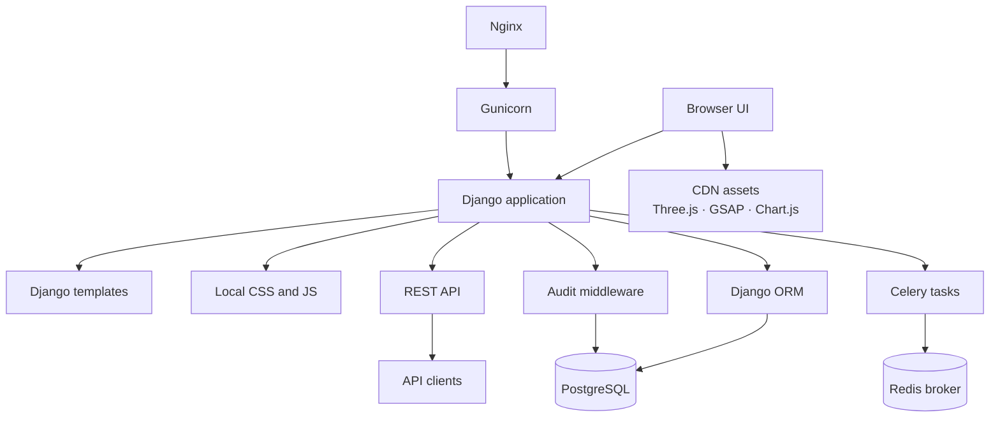
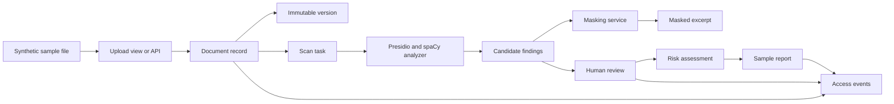
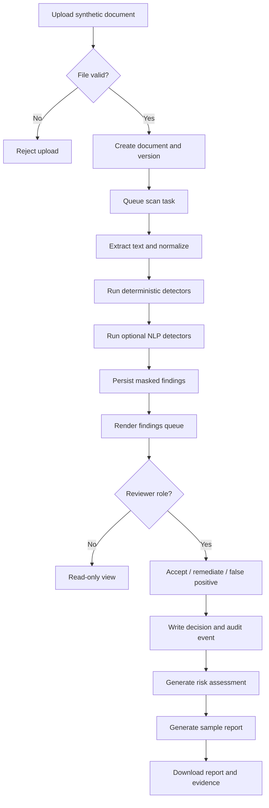
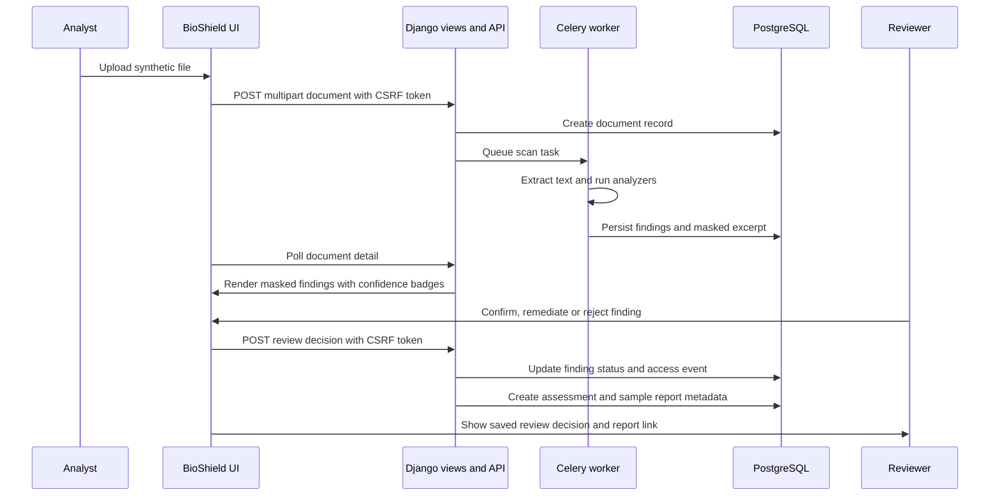
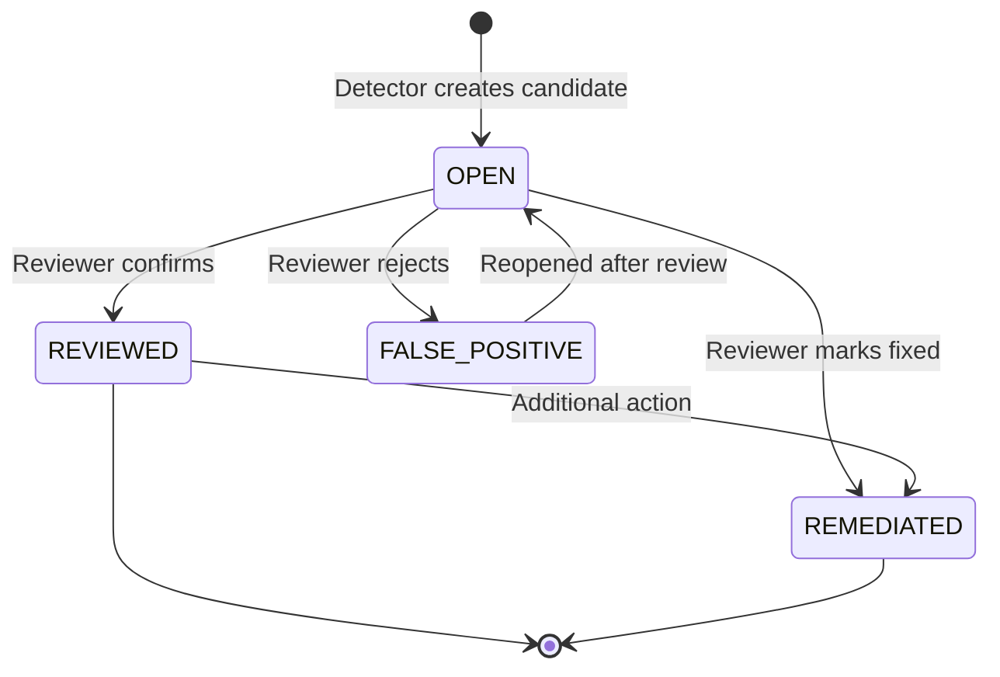
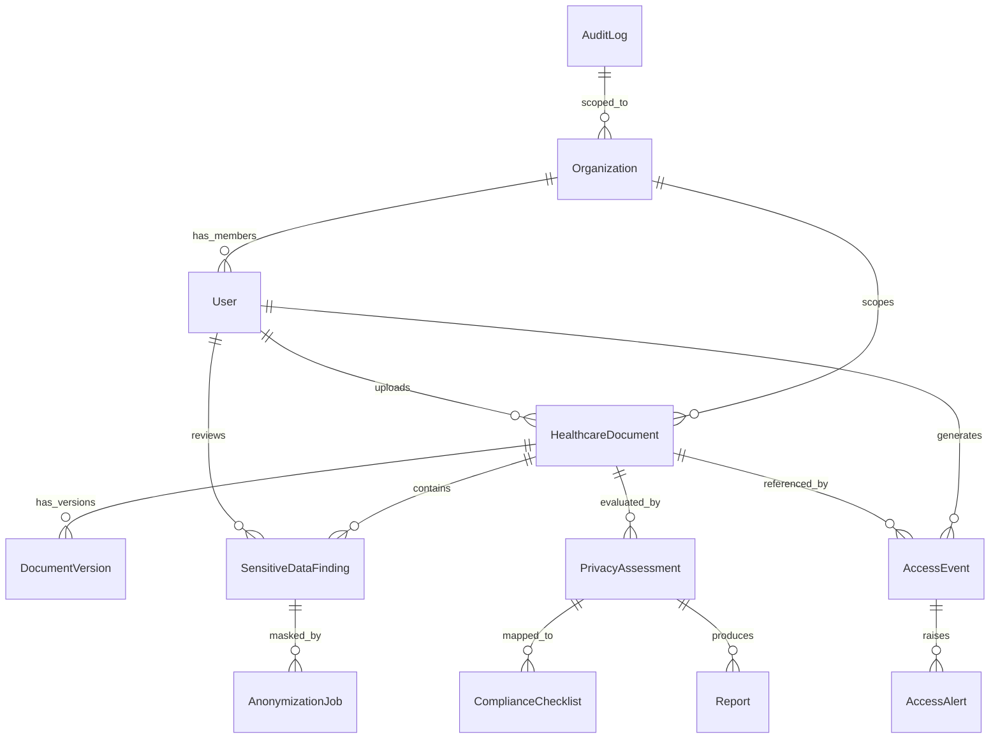
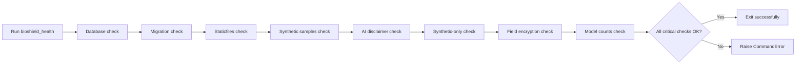
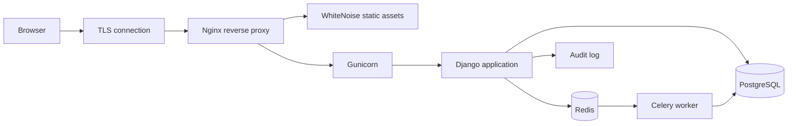

# BIO-SHIELD

**BIO-SHIELD** is a synthetic-data workspace for learning, demonstrating and testing clinical document de-identification, risk assessment, access auditing and compliance evidence handling. Every person, organization, email address, identifier and record in this repository is fabricated. The project is deliberately safe: it is a sandbox, not a production clinical system and not a compliance certification tool.

> **Synthetic data only:** Do not upload real patient records. Sample email addresses use the reserved `.invalid` domain and documentation-only IP ranges.

> **Compliance disclaimer:** Automated checklists and generated reports are decision support only. They are not legal certification and do not establish compliance with HIPAA, GDPR, PCI DSS, ISO 27001 or any other law, regulation or standard. Qualified human review is required.

Repository: <https://github.com/Njbalamani/BIO-SHIELD>  
Application source: [`bIO-SHIELD/`](bIO-SHIELD/README.md)  
Author: **n j bala manikantan**

---

## 1. Repository map

This GitHub repository contains one deployable Django project folder plus a top-level overview README.

| Path | Type | Purpose |
| --- | --- | --- |
| `README.md` | Documentation | Top-level repository guide, architecture, diagrams and navigation |
| `LICENSE` | Legal | MIT License with author attribution |
| `bIO-SHIELD/` | Application folder | Complete Django project deployed from this repository |
| `bIO-SHIELD/README.md` | Documentation | Full project README with structure tables, diagrams, workflows and commands |
| `bIO-SHIELD/manage.py` | Entry point | Django management command runner |
| `bIO-SHIELD/config/` | Configuration | Settings, URLs, Celery, middleware and health checks |
| `bIO-SHIELD/docs/` | Documentation | Architecture, API, deployment, security and compliance notes |
| `bIO-SHIELD/docker/` | Deployment | Dockerfile, compose stack and Nginx configuration |
| `bIO-SHIELD/scripts/` | Automation | Windows setup, development and QA scripts |
| `bIO-SHIELD/tests/` | Verification | API, UI and health-command regression tests |

### 1.1 Top-level tree

```text
BIO-SHIELD/
├── README.md
├── LICENSE
└── bIO-SHIELD/
    ├── README.md
    ├── manage.py
    ├── requirements.txt
    ├── ruff.toml
    ├── accounts/
    ├── analysis/
    ├── audit/
    ├── compliance/
    ├── config/
    ├── dashboard/
    ├── documents/
    ├── organizations/
    ├── reports/
    ├── templates/
    ├── static/
    ├── samples/
    ├── docs/
    ├── docker/
    ├── scripts/
    └── tests/
```

---

## 2. What the platform does

BIO-SHIELD models the full lifecycle of a synthetic clinical document:

1. A synthetic file is uploaded into an organization-scoped workspace.
2. An immutable document version is recorded.
3. Deterministic rules and optional local NLP analyzers propose candidate identifiers.
4. Candidates are stored as masked findings with confidence, severity and methodology.
5. A human reviewer confirms, remediates or rejects each finding through the UI or API.
6. Risk assessments are generated from explainable finding snapshots.
7. Access events are recorded and monitored for anomalies.
8. Sample PDF reports and audit evidence are produced with explicit limitations.

| Stage | Input | Output | Human gate |
| --- | --- | --- | --- |
| Ingest | Synthetic PDF, TXT or DOCX | Document record and version | No |
| Extract | Uploaded file | Normalized text | No |
| Detect | Extracted text | Candidate findings | No |
| Mask | Candidates | Masked excerpt and fingerprints | No |
| Review | Candidates | Reviewer decision and audit event | **Yes** |
| Assess | Reviewed context | Risk score and level | Optional |
| Report | Assessments, findings, evidence | Sample PDF and register entry | **Yes** |
| Audit | Active session | Access events and alerts | Ongoing |

---

## 3. Architecture diagram



### 3.1 Layer responsibilities

| Layer | Technology | Responsibility |
| --- | --- | --- |
| Presentation | HTML, CSS, JavaScript | Responsive glassmorphism UI, charts and animated shield |
| Web | Django 6.x | Routing, templates, authentication, ORM and admin |
| API | Django REST Framework | JSON endpoints, token/session auth and throttling |
| Async | Celery and Redis | Document scanning, masking, monitoring and reporting |
| Data | PostgreSQL | Durable application records and audit trail |
| Detection | Presidio and spaCy | Rule-based and model-assisted entity detection |
| Analysis | scikit-learn, pandas, numpy | Risk score support and anomaly logic |
| Documents | PyPDF, python-docx, reportlab | Extraction and sample report generation |
| Security | cryptography, WhiteNoise, CORS | Field encryption, static delivery and policy headers |
| Serving | Gunicorn and Nginx | Production process and reverse proxy |
| Tooling | ruff and pytest/Django test | Lint, format and regression verification |

---

## 4. End-to-end data flow



### 4.1 Detailed lifecycle flowchart



---

## 5. Review workflow

The human review gate is a first-class part of the workflow. Reviewers can record decisions from the Findings screen or through the API. The UI never decrypts or displays the raw candidate value; the API may return a decrypted value only to an authorized reviewer and records that disclosure in the audit trail.



### 5.1 Finding status state diagram



---

## 6. Entity relationship overview



| Model | Key fields | Purpose |
| --- | --- | --- |
| `Organization` | `id`, `name`, `slug`, `created_at` | Synthetic workspace boundary |
| `User` | `id`, `username`, `email`, `role`, `organization` | Authentication and reviewer identity |
| `HealthcareDocument` | `id`, `title`, `file_type`, `status`, `text_extract` | Uploaded synthetic file |
| `DocumentVersion` | `id`, `document`, `version_number`, `filename` | Immutable upload version |
| `SensitiveDataFinding` | `id`, `finding_type`, `confidence`, `severity`, `status` | Candidate identifier and disposition |
| `AnonymizationJob` | `id`, `document`, `status`, `output_file` | Applied masking transformation |
| `AccessEvent` | `id`, `document`, `action`, `ip_address`, `occurred_at` | Access audit stream |
| `AccessAlert` | `id`, `event`, `severity`, `title`, `status` | Access anomaly alert |
| `PrivacyAssessment` | `id`, `document`, `risk_score`, `risk_level` | Explainable risk evaluation |
| `ComplianceChecklist` | `id`, `framework`, `status`, `score` | Internal checklist evidence |
| `Report` | `id`, `title`, `format`, `file`, `summary` | Generated PDF register |
| `AuditLog` | `id`, `user`, `action`, `target_type`, `metadata` | Sanitized administrative trail |

---

## 7. Module responsibility table

| Module | Responsibility |
| --- | --- |
| `config/` | Settings, ASGI/WSGI, Celery, middleware, API router and health checks |
| `accounts/` | Registration, login, logout and role-aware account views |
| `organizations/` | Tenant-style synthetic workspace boundaries |
| `documents/` | Upload, storage, versions, findings, masking jobs and access events |
| `analysis/` | Detection orchestration, masking strategies, risk scoring and AI status |
| `compliance/` | Framework mappings and internal control checklists |
| `dashboard/` | Metrics aggregation and chart data serialization |
| `reports/` | Sample report generation and report register |
| `audit/` | Sanitized administrative audit log |
| `templates/` | Base layout and feature templates |
| `static/` | Custom CSS, JavaScript and SVG assets |
| `samples/` | Clearly labelled synthetic documents and generator script |
| `docs/` | Architecture, API, deployment, security and compliance documentation |
| `docker/` | Dockerfile, compose stack and Nginx configuration |
| `scripts/` | Windows setup, development and QA helpers |
| `tests/` | API, UI and management-command tests |

---

## 8. API surface

The REST surface is available under `/api/`. Session and token authentication are supported and state-changing requests require CSRF for session clients.

| Endpoint | Methods | Description |
| --- | --- | --- |
| `/api/auth/register/` | POST | Create a synthetic workspace account |
| `/api/auth/login/` | POST | Obtain an API token |
| `/api/auth/logout/` | POST | Revoke the current token |
| `/api/auth/me/` | GET | Inspect the current account |
| `/api/organizations/` | GET, POST | List or create workspaces |
| `/api/documents/` | GET, POST | List or upload documents |
| `/api/documents/{id}/download/` | GET | Download an original document |
| `/api/documents/{id}/analyze/` | POST | Queue document analysis |
| `/api/documents/{id}/anonymize/` | POST | Queue redaction |
| `/api/document-versions/` | GET, POST | List or add versions |
| `/api/findings/` | GET | List candidate findings |
| `/api/findings/{id}/review/` | POST | Record a human review decision |
| `/api/assessments/` | GET, POST | List or create assessments |
| `/api/assessments/generate/` | POST | Build an assessment from findings |
| `/api/anonymization-jobs/` | GET, POST | List or create masking operations |
| `/api/access-events/` | GET | Query the access audit stream |
| `/api/access-events/monitor/` | POST | Queue anomaly monitoring |
| `/api/alerts/` | GET, PATCH | Review generated alerts |
| `/api/checklists/` | GET, POST | List internal checklist items |
| `/api/reports/` | GET, POST | List reports |
| `/api/reports/generate/` | POST | Build a sample PDF report |
| `/api/audit-logs/` | GET | Inspect sanitized audit history |
| `/api/dashboard/metrics/` | GET | Read organization-scoped metrics |
| `/api/ai/status/` | GET | Inspect local AI status and disclaimers |
| `/health/live/` | GET | Liveness probe |
| `/health/ready/` | GET | Readiness probe with database check |

Full endpoint documentation lives in [`bIO-SHIELD/docs/api.md`](bIO-SHIELD/docs/api.md).

---

## 9. Quick start

Run all commands from the `bIO-SHIELD/` folder.

```powershell
py -3.12 -m venv .venv
.\.venv\Scripts\Activate.ps1
python -m pip install --upgrade pip
python -m pip install -r requirements.txt
Copy-Item .env.example .env
python manage.py migrate
python manage.py collectstatic --noinput
python manage.py runserver 127.0.0.1:8000
```

For the full Windows QA sequence:

```powershell
scripts\verify.ps1
```

For Docker:

```powershell
docker compose -f docker/docker-compose.yml --env-file .env up --build -d
```

See [`bIO-SHIELD/README.md`](bIO-SHIELD/README.md) and [`bIO-SHIELD/docs/deployment.md`](bIO-SHIELD/docs/deployment.md) for complete details.

---

## 10. Environment configuration

| Variable | Description |
| --- | --- |
| `DJANGO_SECRET_KEY` / `SECRET_KEY` | Django secret key |
| `DEBUG` | Debug flag; keep `False` outside local development |
| `ALLOWED_HOSTS` | Comma-separated hostnames |
| `POSTGRES_DB`, `POSTGRES_USER`, `POSTGRES_PASSWORD` | PostgreSQL credentials |
| `POSTGRES_HOST`, `POSTGRES_PORT` | PostgreSQL connection location |
| `REDIS_URL` | Celery broker and result backend URL |
| `CELERY_TASK_ALWAYS_EAGER` | Execute tasks inline when `True` |
| `SECURE_SSL_REDIRECT` | Force HTTPS in production |
| `SESSION_COOKIE_SECURE`, `CSRF_COOKIE_SECURE` | Harden cookies |
| `CONTENT_SECURITY_POLICY` | CSP allowing app assets and required CDNs |
| `API_THROTTLE_ANON`, `API_THROTTLE_USER` | API rate limits |
| `MAX_UPLOAD_SIZE_MB` | Upload size cap |
| `RETENTION_DAYS` | Audit and document retention window |
| `SYNTHETIC_DATA_ONLY` | Enforces synthetic-only demonstration mode |
| `ENABLE_PRESIDIO`, `ENABLE_SPACY_MODEL` | Analyzer feature switches |
| `FIELD_ENCRYPTION_KEY` | Fernet key for sensitive field encryption |
| `SCAN_TIMEOUT_SECONDS` | Maximum scan duration |

---

## 11. Verification

The project includes a complete QA script and a health command.

| Check | Command |
| --- | --- |
| Python compile | `python -m compileall -q .` |
| Lint | `ruff check .` |
| Format | `ruff format --check .` |
| Django check | `python manage.py check` |
| Migration drift | `python manage.py makemigrations --check --dry-run` |
| Tests | `python manage.py test` |
| Synthetic samples | `python samples/generate_synthetic_documents.py` |
| Deployment health | `python manage.py bioshield_health --json` |
| Docker validation | `docker compose -f docker/docker-compose.yml config` |

### 11.1 Health checks



---

## 12. Deployment topology



| Service | Image/base | Role |
| --- | --- | --- |
| `db` | PostgreSQL | Persistent application data |
| `redis` | Redis | Celery broker and result backend |
| `web` | Python/Django | Gunicorn application server |
| `celery` | Python/Django | Background task worker |
| `nginx` | Nginx | Reverse proxy and static delivery |

---

## 13. Security and compliance posture

| Control | Implementation | Limitation |
| --- | --- | --- |
| Organization scoping | Queryset filters and membership permissions | Demo-grade authorization model |
| Human review gate | UI and API review actions with audit events | Human judgment still required |
| Field encryption | Fernet encryption for sensitive values | Key management must be production-grade |
| Access auditing | Access events, alerts and sanitized audit log | Not a full SIEM |
| Transport hardening | HTTPS redirect, HSTS, secure cookies | Requires correct proxy configuration |
| Content policy | CSP and permissions policy | CDNs must remain allowed |
| Synthetic-only mode | Default setting and health check | Users must still avoid real records |

> BIO-SHIELD is educational decision-support software. It does not certify compliance and must not be represented as proof of compliance to any external party.

---

## 14. Documentation index

| Document | Content |
| --- | --- |
| [`bIO-SHIELD/README.md`](bIO-SHIELD/README.md) | Complete project guide |
| [`bIO-SHIELD/docs/architecture.md`](bIO-SHIELD/docs/architecture.md) | Architecture notes |
| [`bIO-SHIELD/docs/api.md`](bIO-SHIELD/docs/api.md) | REST API reference |
| [`bIO-SHIELD/docs/deployment.md`](bIO-SHIELD/docs/deployment.md) | Deployment guide |
| [`bIO-SHIELD/docs/security.md`](bIO-SHIELD/docs/security.md) | Security controls |
| [`bIO-SHIELD/docs/er-diagram.md`](bIO-SHIELD/docs/er-diagram.md) | Entity relationships |
| [`bIO-SHIELD/docs/compliance-disclaimer.md`](bIO-SHIELD/docs/compliance-disclaimer.md) | Compliance limitations |

---

## 15. License

Released under the MIT License.

**Copyright (c) 2026 n j bala manikantan**

See [`LICENSE`](LICENSE) for the full text.
