# BIO-SHIELD Application

This is the deployable Django application corresponding to the top-level GitHub repository <https://github.com/Njbalamani/BIO-SHIELD>. It lives in the repository folder `bIO-SHIELD/`.

BIO-SHIELD is a synthetic-data workspace for exploring clinical document de-identification, risk assessment, access auditing and compliance evidence handling. It is a demonstration platform: every record, name, identifier and domain in the repository is fabricated.

> **Synthetic data warning:** The project contains no real patient records. Do not upload real clinical documents. Sample email addresses use the reserved `.invalid` domain and example-only IP ranges.

> **Compliance disclaimer:** Automated compliance checklists in BIO-SHIELD are decision-support tooling only. They are **not legal certification** and do not establish compliance with HIPAA, GDPR, PCI DSS, ISO 27001 or any other law, regulation or standard. Qualified human review and professional advice are required.

Author: **n j bala manikantan**  
License: MIT — see [`LICENSE`](LICENSE).

---

## Table of contents

1. [Objective](#1-objective)
2. [Full project structure](#2-full-project-structure)
3. [Architecture](#3-architecture)
4. [Data flow and processing pipeline](#4-data-flow-and-processing-pipeline)
5. [Workflow flowcharts](#5-workflow-flowcharts)
6. [Human review gate](#6-human-review-gate)
7. [Module reference](#7-module-reference)
8. [Database reference](#8-database-reference)
9. [Entity relationship diagram](#9-entity-relationship-diagram)
10. [REST API reference](#10-rest-api-reference)
11. [UI routes reference](#11-ui-routes-reference)
12. [Technology stack](#12-technology-stack)
13. [Installation and local development](#13-installation-and-local-development)
14. [Environment configuration](#14-environment-configuration)
15. [Docker deployment](#15-docker-deployment)
16. [Management commands and QA](#16-management-commands-and-qa)
17. [Health check workflow](#17-health-check-workflow)
18. [Security model](#18-security-model)
19. [Synthetic samples](#19-synthetic-samples)
20. [Troubleshooting](#20-troubleshooting)
21. [Documentation files](#21-documentation-files)
22. [License](#22-license)

---

## 1. Objective

The objective is to provide a realistic, safe environment where privacy engineers, reviewers and administrators can practise the full document-protection lifecycle:

1. Ingest fabricated clinical documents and access logs.
2. Detect candidate identifiers with deterministic rules and model-assisted analysis.
3. Mask or generalize candidates under a documented methodology.
4. Record reviewer decisions and risk scores.
5. Produce sample reports and audit evidence with clear limitations.

The UI intentionally keeps a human review gate in the workflow and displays the synthetic-only status throughout.

### 1.1 Capability matrix

| Capability | UI | API | Background task | Human required |
| --- | --- | --- | --- | --- |
| Upload synthetic document | Yes | Yes | No | No |
| Record document version | Automatic | Yes | No | No |
| Scan and detect findings | Indirect | Yes | Yes | No |
| Review finding | Yes | Yes | No | **Yes** |
| Generate risk assessment | Indirect | Yes | Optional | Recommended |
| Run anonymization | Indirect | Yes | Yes | Recommended |
| Monitor access events | Indirect | Yes | Yes | No |
| Acknowledge access alert | Limited | Yes | No | **Yes** |
| Generate sample report | Limited | Yes | Yes | Recommended |
| Inspect audit log | Yes | Yes | No | No |

---

## 2. Full project structure

### 2.1 Root-level tree

```text
bIO-SHIELD/
├── manage.py
├── requirements.txt
├── ruff.toml
├── .env.example
├── .gitignore
├── README.md
├── LICENSE
├── accounts/
├── analysis/
├── audit/
├── compliance/
├── config/
├── dashboard/
├── documents/
├── organizations/
├── reports/
├── templates/
├── static/
├── samples/
├── docs/
├── docker/
├── scripts/
├── tests/
├── media/
└── staticfiles/
```

> `media/` and `staticfiles/` are runtime output directories and are excluded from source control. `.venv/`, `__pycache__/`, `.ruff_cache/` and `.test.sqlite3` are also local-only artifacts.

### 2.2 Application module tree

```text
bIO-SHIELD/
├── accounts/
│   ├── migrations/
│   ├── admin.py
│   ├── api.py
│   ├── apps.py
│   ├── models.py
│   ├── serializers.py
│   ├── urls.py
│   └── views.py
├── analysis/
│   ├── engines/
│   │   ├── access.py
│   │   ├── anonymization.py
│   │   ├── detection.py
│   │   ├── extraction.py
│   │   └── risk.py
│   ├── api.py
│   ├── services.py
│   ├── tasks.py
│   ├── tests.py
│   └── views.py
├── audit/
│   ├── migrations/
│   ├── admin.py
│   ├── api.py
│   ├── apps.py
│   ├── models.py
│   ├── serializers.py
│   ├── services.py
│   ├── urls.py
│   └── views.py
├── compliance/
│   ├── migrations/
│   ├── admin.py
│   ├── api.py
│   ├── apps.py
│   ├── models.py
│   ├── serializers.py
│   ├── services.py
│   ├── tasks.py
│   ├── urls.py
│   └── views.py
├── config/
│   ├── management/commands/
│   ├── api_router.py
│   ├── asgi.py
│   ├── celery.py
│   ├── health.py
│   ├── middleware.py
│   ├── settings.py
│   ├── urls.py
│   └── wsgi.py
├── dashboard/
│   ├── migrations/
│   ├── admin.py
│   ├── api.py
│   ├── apps.py
│   ├── serializers.py
│   ├── services.py
│   ├── urls.py
│   └── views.py
├── documents/
│   ├── migrations/
│   ├── admin.py
│   ├── api.py
│   ├── apps.py
│   ├── models.py
│   ├── serializers.py
│   ├── services.py
│   ├── tasks.py
│   ├── tests.py
│   ├── urls.py
│   ├── validators.py
│   └── views.py
├── organizations/
│   ├── migrations/
│   ├── admin.py
│   ├── api.py
│   ├── apps.py
│   ├── models.py
│   ├── serializers.py
│   ├── services.py
│   ├── urls.py
│   └── views.py
└── reports/
    ├── migrations/
    ├── admin.py
    ├── api.py
    ├── apps.py
    ├── models.py
    ├── serializers.py
    ├── services.py
    ├── tasks.py
    ├── urls.py
    └── views.py
```

### 2.3 Asset and documentation tree

```text
bIO-SHIELD/
├── templates/
│   ├── base.html
│   ├── index.html
│   ├── access/
│   ├── accounts/
│   ├── anonymization/
│   ├── assessments/
│   ├── audit/
│   ├── compliance/
│   ├── dashboard/
│   ├── documents/
│   ├── findings/
│   ├── organizations/
│   └── reports/
├── static/
│   ├── css/main.css
│   ├── images/
│   └── js/
│       ├── dashboard.js
│       ├── highlight.js
│       ├── main.js
│       └── shield.js
├── samples/
│   ├── generate_synthetic_documents.py
│   ├── synthetic_access_events.csv
│   ├── synthetic_clinical_notes.docx
│   ├── synthetic_clinical_notes.txt
│   ├── synthetic_patient_summary.pdf
│   ├── synthetic_patient_summary.txt
│   └── README.md
├── docs/
│   ├── api.md
│   ├── architecture.md
│   ├── compliance-disclaimer.md
│   ├── deployment.md
│   ├── er-diagram.md
│   ├── security.md
│   └── sample-reports/
├── docker/
│   ├── Dockerfile
│   ├── docker-compose.yml
│   └── nginx/nginx.conf
├── scripts/
│   ├── dev.ps1
│   ├── setup.ps1
│   └── verify.ps1
└── tests/
    ├── test_api.py
    ├── test_bioshield_health_command.py
    └── test_ui.py
```

### 2.4 File responsibility table

| Path | Responsibility |
| --- | --- |
| `manage.py` | Django command-line entry point |
| `requirements.txt` | Pinned compatible dependency ranges |
| `ruff.toml` | Lint and formatting configuration |
| `.env.example` | Template for local and production environment variables |
| `config/settings.py` | Application, database, security, Celery and storage settings |
| `config/urls.py` | Root URL routing for UI, API, admin and health endpoints |
| `config/api_router.py` | DRF router registration for all viewsets |
| `config/celery.py` | Celery application instance |
| `config/middleware.py` | Request identifiers and security response headers |
| `config/health.py` | Liveness and readiness endpoints |
| `config/management/commands/bioshield_health.py` | Deployment health report command |
| `documents/models.py` | Core document, finding, version, job and access models |
| `documents/services.py` | Upload, masking, audit, access and scoping services |
| `documents/api.py` | Document, finding, job and access API viewsets |
| `documents/views.py` | Document and finding UI views |
| `analysis/engines/detection.py` | Candidate identifier detection |
| `analysis/engines/anonymization.py` | Masking transformations |
| `analysis/engines/risk.py` | Risk score calculation |
| `analysis/engines/access.py` | Access anomaly analysis |
| `analysis/services.py` | Analyzer orchestration and shared review logic |
| `reports/services.py` | Sample report rendering |
| `compliance/services.py` | Checklist construction and evaluation |
| `dashboard/services.py` | Metrics aggregation |
| `audit/services.py` | Sanitized audit write path |
| `templates/base.html` | Shared layout, navigation and synthetic-only messaging |
| `static/js/main.js` | Table filters, overlays, toasts and CSRF-aware fetch helper |
| `static/js/dashboard.js` | Chart rendering |
| `static/js/highlight.js` | Masked excerpt highlighting |
| `static/js/shield.js` | Animated Three.js/GSAP shield |
| `scripts/verify.ps1` | Full Windows QA sequence |
| `scripts/dev.ps1` | Local development helpers |
| `scripts/setup.ps1` | Environment setup helper |

---

## 3. Architecture

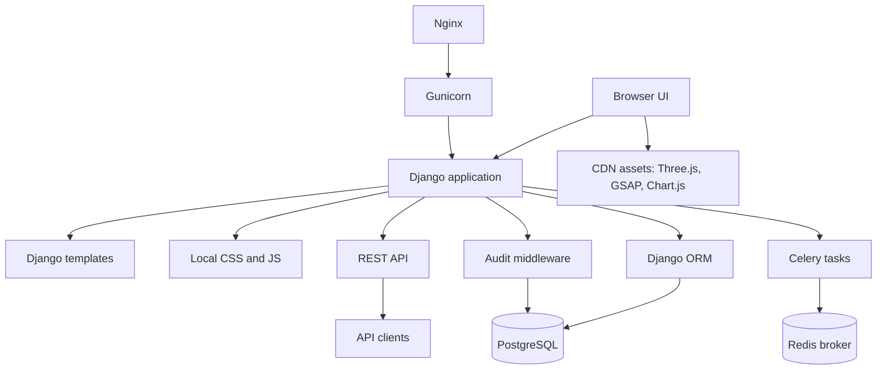

### 3.1 Request lifecycle

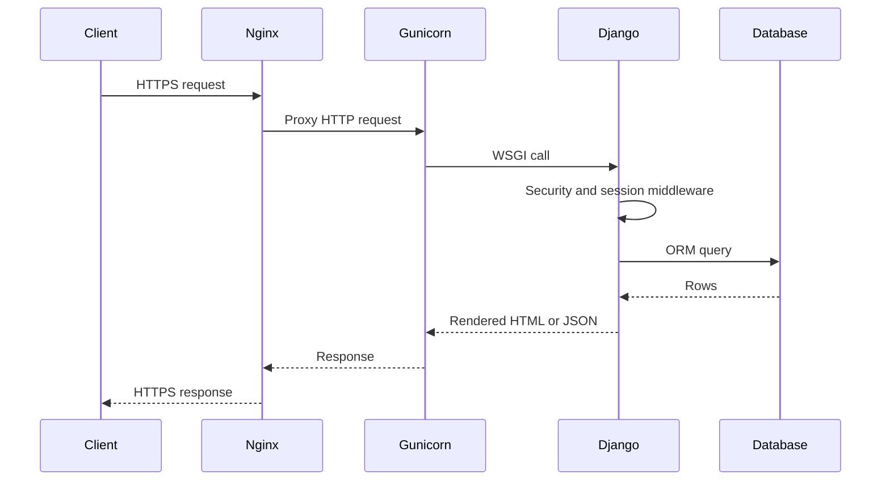

### 3.2 Deployment topology

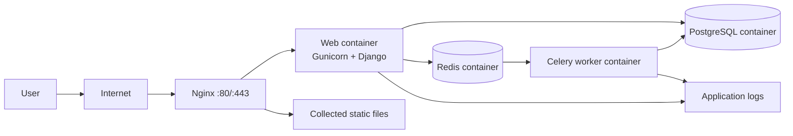

---

## 4. Data flow and processing pipeline

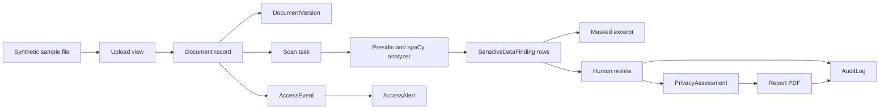

### 4.1 Analyzer pipeline

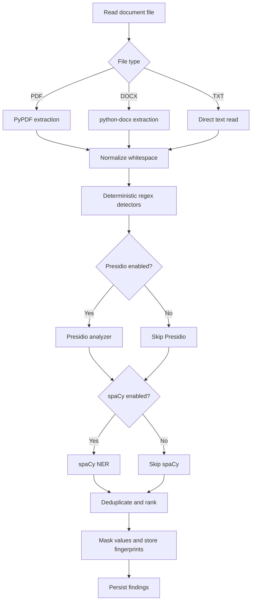

---

## 5. Workflow flowcharts

### 5.1 Document lifecycle

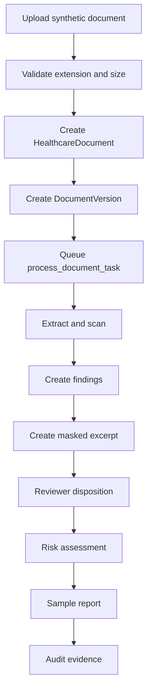

### 5.2 Scan and review workflow

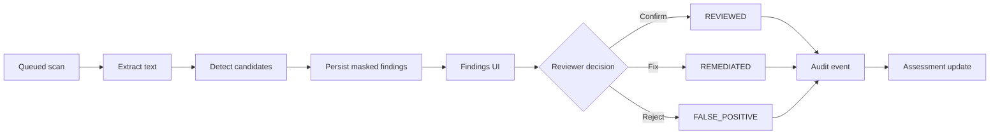

### 5.3 Access monitoring workflow

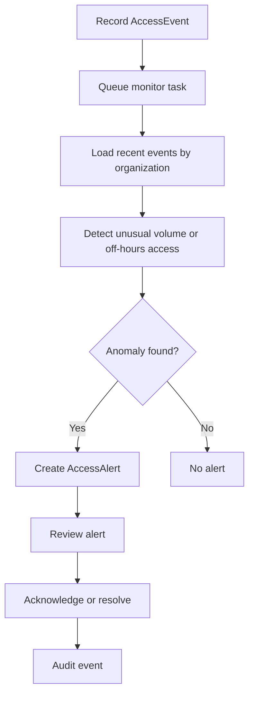

### 5.4 Report generation workflow

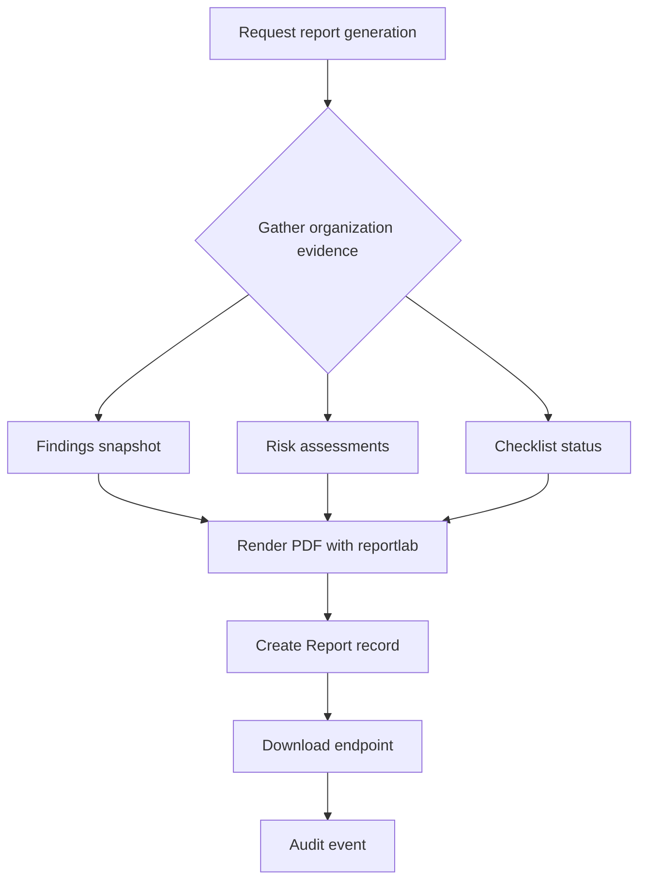

### 5.5 Sequence diagram with all actors

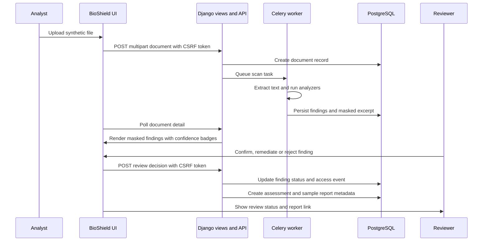

---

## 6. Human review gate

The review gate is implemented in both the UI and API.

| Decision | Stored status | Meaning | Masked value shown in UI |
| --- | --- | --- | --- |
| Confirm | `REVIEWED` | Reviewer accepts candidate as valid | Yes |
| Fix applied | `REMEDIATED` | Reviewer records remediation | Yes |
| Reject | `FALSE_POSITIVE` | Reviewer determines candidate is not sensitive | Yes |
| Default API decision | `REVIEWED` | Used when no valid status is supplied | API may reveal to authorized reviewer |

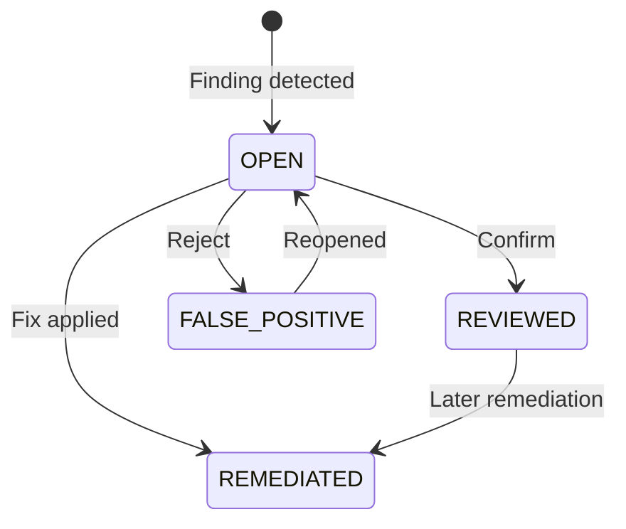

Implementation details:

| File | Role |
| --- | --- |
| `analysis/services.py` | Shared `review_finding()` logic and `mask_for_review()` |
| `documents/api.py` | `POST /api/findings/{id}/review/` |
| `documents/views.py` | `FindingReviewView` for the HTML form |
| `documents/urls.py` | `findings:review` URL |
| `templates/findings/list.html` | Review controls for authorized roles |
| `audit/services.py` | Sanitized audit write path |

---

## 7. Module reference

| Module | Primary files | Responsibility |
| --- | --- | --- |
| `accounts` | `models.py`, `api.py`, `views.py` | User roles, registration, authentication and account pages |
| `organizations` | `models.py`, `services.py`, `api.py` | Workspace boundaries and membership scoping |
| `documents` | `models.py`, `services.py`, `api.py`, `views.py` | Upload, versions, findings, anonymization and access events |
| `analysis` | `engines/`, `services.py`, `tasks.py` | Detection, masking, risk scoring and AI status |
| `compliance` | `models.py`, `services.py`, `api.py` | Framework mappings and internal checklists |
| `dashboard` | `services.py`, `views.py`, `api.py` | Metrics and chart data |
| `reports` | `services.py`, `models.py`, `api.py` | PDF generation and report register |
| `audit` | `models.py`, `services.py`, `api.py` | Sanitized administrative audit log |
| `config` | `settings.py`, `urls.py`, `api_router.py` | Project configuration and routing |

### 7.1 Application file map

| Layer | Files | Notes |
| --- | --- | --- |
| Models | `models.py` in each app | Django ORM definitions |
| Views | `views.py` in each app | HTML pages |
| APIs | `api.py` in each app | DRF viewsets and actions |
| Serializers | `serializers.py` | API representation and validation |
| Services | `services.py` | Reusable business logic |
| Tasks | `tasks.py` | Celery background jobs |
| URLs | `urls.py` | App-level routing |
| Admin | `admin.py` | Django admin registrations |
| Migrations | `migrations/` | Schema history |

---

## 8. Database reference

| Table / model | Key fields | Purpose |
| --- | --- | --- |
| `organizations_organization` | `id`, `name`, `slug`, `created_at` | Groups users and documents |
| `accounts_user` | `id`, `username`, `email`, `role` | Authentication and reviewer identity |
| `documents_healthcaredocument` | `id`, `title`, `file_type`, `status`, `text_extract` | Uploaded synthetic files |
| `documents_documentversion` | `id`, `document`, `version_number`, `filename` | Immutable upload versions |
| `documents_sensitivedatafinding` | `id`, `document`, `finding_type`, `severity`, `value_masked` | Candidate identifiers and masked values |
| `documents_anonymizationjob` | `id`, `document`, `status`, `output_file` | Applied masking transformations |
| `documents_accessevent` | `id`, `document`, `action`, `ip_address`, `occurred_at` | Access audit stream |
| `documents_accessalert` | `id`, `event`, `severity`, `title`, `status` | Access anomaly alerts |
| `compliance_privacyassessment` | `id`, `document`, `risk_score`, `risk_level`, `findings_snapshot` | Explainable risk evaluations |
| `compliance_compliancechecklist` | `id`, `framework`, `status`, `score` | Internal checklist evidence |
| `reports_report` | `id`, `title`, `format`, `file`, `summary` | Generated PDF report register |
| `audit_auditlog` | `id`, `user`, `action`, `target_type`, `metadata` | Sanitized administrative audit trail |

### 8.1 Finding fields

| Field | Type | Purpose |
| --- | --- | --- |
| `finding_type` | CharField | Detected entity label |
| `category` | CharField | Broad classification |
| `value_masked` | CharField | Safe display value |
| `value_ciphertext` | TextField | Encrypted value for authorized review |
| `fingerprint` | CharField | Non-reversible duplicate detection |
| `confidence` | FloatField | Detector confidence |
| `methodology` | CharField | Detector or rule name |
| `severity` | CharField | Low, medium or high |
| `status` | CharField | Review disposition |
| `reviewed_by` | ForeignKey | Reviewer identity |
| `reviewed_at` | DateTimeField | Review timestamp |

---

## 9. Entity relationship diagram

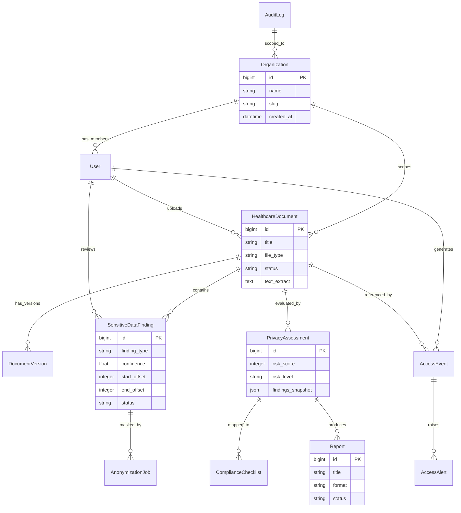

---

## 10. REST API reference

The REST surface is available under `/api/`. Authentication uses Django session or token credentials and state-changing requests require a CSRF token for session clients.

| Endpoint | Methods | Description |
| --- | --- | --- |
| `/api/auth/register/` | POST | Create a synthetic workspace account |
| `/api/auth/login/` | POST | Obtain a session or token credential |
| `/api/auth/logout/` | POST | End the current session |
| `/api/auth/me/` | GET | Inspect the current account |
| `/api/organizations/` | GET, POST | List or create workspace organizations |
| `/api/documents/` | GET, POST | List and upload synthetic documents |
| `/api/documents/{id}/download/` | GET | Download an original document |
| `/api/documents/{id}/analyze/` | POST | Queue document analysis |
| `/api/documents/{id}/anonymize/` | POST | Queue redaction into a downloadable file |
| `/api/documents/{id}/access/` | GET, POST | Read or record access events |
| `/api/document-versions/` | GET, POST | List or add document versions |
| `/api/findings/` | GET | List candidate findings with confidence and status |
| `/api/findings/{id}/review/` | POST | Record a human review decision |
| `/api/assessments/` | GET, POST | List or create risk assessments |
| `/api/assessments/generate/` | POST | Build an assessment from stored findings |
| `/api/anonymization-jobs/` | GET, POST | List and create masking operations |
| `/api/anonymization-jobs/{id}/download/` | GET | Download redacted output |
| `/api/access-events/` | GET | Query the audit stream |
| `/api/access-events/monitor/` | POST | Queue access anomaly monitoring |
| `/api/alerts/` | GET, PATCH | Review generated access alerts |
| `/api/checklists/` | GET, POST | List internal checklist items |
| `/api/reports/` | GET, POST | List reports |
| `/api/reports/{id}/download/` | GET | Download a generated PDF report |
| `/api/reports/generate/` | POST | Build a PDF report from workspace evidence |
| `/api/audit-logs/` | GET | Inspect sanitized audit history |
| `/api/dashboard/metrics/` | GET | Read organization-scoped metrics |
| `/api/ai/status/` | GET | Inspect local AI engine status and disclaimers |
| `/health/live/` | GET | Liveness probe |
| `/health/ready/` | GET | Readiness probe including database check |

Full API details are in [`docs/api.md`](docs/api.md).

### 10.1 API request flow

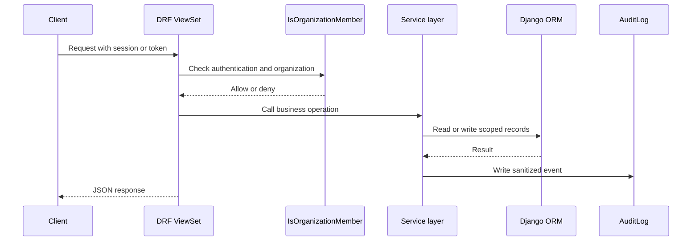

---

## 11. UI routes reference

| Route | View | Template | Purpose |
| --- | --- | --- | --- |
| `/` | `DashboardView` | `dashboard/home.html` | Landing dashboard |
| `/dashboard/` | `DashboardView` | `dashboard/home.html` | Metrics and charts |
| `/documents/` | `DocumentListView` | `documents/list.html` | Document register |
| `/documents/upload/` | `DocumentUploadView` | `documents/upload.html` | Synthetic upload form |
| `/documents/{id}/` | `DocumentDetailView` | `documents/detail.html` | Document inspection |
| `/findings/` | `FindingListView` | `findings/list.html` | Candidate register and review controls |
| `/findings/{id}/review/` | `FindingReviewView` | Redirect | Record reviewer decision |
| `/assessments/` | `AssessmentListView` | `assessments/list.html` | Risk assessment register |
| `/anonymization/` | `AnonymizationJobListView` | `anonymization/list.html` | Masking job register |
| `/access/` | `AccessListView` | `access/list.html` | Access events and alerts |
| `/compliance/` | `ComplianceListView` | `compliance/list.html` | Checklist evidence |
| `/reports/` | `ReportListView` | `reports/list.html` | Report register |
| `/organizations/` | `OrganizationListView` | `organizations/list.html` | Workspace list |
| `/audit/` | `AuditListView` | `audit/list.html` | Sanitized audit trail |
| `/accounts/login/` | Login view | `accounts/login.html` | Sign in |
| `/accounts/register/` | Register view | `accounts/register.html` | Create account |

### 11.1 Navigation flow

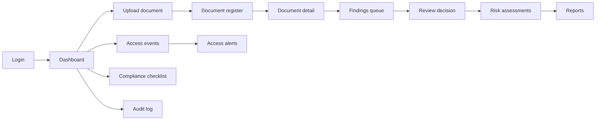

---

## 12. Technology stack

| Layer | Technology | Purpose |
| --- | --- | --- |
| Backend | Django 6.x | Web framework, ORM, templating and auth |
| API | Django REST Framework | JSON API surface |
| Async | Celery and Redis | Scan and report tasks |
| Database | PostgreSQL | Persistent application data |
| Frontend | HTML, CSS, JavaScript | Glassmorphism UI with responsive layout |
| Visualization | Chart.js | Findings, severity and risk charts |
| 3D | Three.js and GSAP | Animated shield scene |
| Detection | Presidio Analyzer and Anonymizer | Rule-based entity detection and masking |
| NLP | spaCy 3.8 and English model | Model-assisted entity recognition |
| ML | scikit-learn, pandas, numpy | Risk scoring and data handling |
| Documents | PyPDF, python-docx, reportlab | Document extraction and sample generation |
| Security | cryptography, WhiteNoise, django-cors-headers | Encryption, static files and CORS policy |
| Serving | Gunicorn and Nginx | Production web stack |
| Tooling | ruff, Django test | Linting and tests |

### 12.1 Dependencies

| Package | Range | Used for |
| --- | --- | --- |
| `Django` | `>=6.1,<7` | Core framework |
| `djangorestframework` | `>=3.15,<4` | REST API |
| `django-cors-headers` | `>=4.4,<5` | CORS policy |
| `psycopg2-binary` | `>=2.9,<3` | PostgreSQL driver |
| `celery` | `>=5.4,<6` | Background tasks |
| `redis` | `>=5.0,<6` | Broker client |
| `gunicorn` | `>=22.0,<24` | WSGI server |
| `whitenoise` | `>=6.7,<7` | Static file serving |
| `python-dotenv` | `>=1.0,<2` | Environment files |
| `spacy` | `>=3.8,<3.9` | NLP |
| `en_core_web_sm` | `3.8.0` | English spaCy model |
| `scikit-learn` | `>=1.5,<2` | ML utilities |
| `pandas` | `>=2.2,<3` | Data handling |
| `numpy` | `>=2.0,<3` | Numerical operations |
| `PyPDF` | `>=5.0,<6` | PDF extraction |
| `python-docx` | `>=1.1,<2` | DOCX extraction |
| `reportlab` | `>=4.2,<5` | PDF generation |
| `cryptography` | `>=43.0,<46` | Encryption |
| `presidio-analyzer` | `>=2.2,<3` | Entity analysis |
| `presidio-anonymizer` | `>=2.2,<3` | Masking |
| `ruff` | `>=0.6,<1` | Lint and format |

---

## 13. Installation and local development

### 13.1 Windows

```powershell
Set-Location C:\Users\bmani\OneDrive\Desktop\BioShield\bIO-SHIELD
py -3.12 -m venv .venv
.\.venv\Scripts\Activate.ps1
python -m pip install --upgrade pip
python -m pip install -r requirements.txt
Copy-Item .env.example .env
notepad .env
python manage.py migrate
python manage.py collectstatic --noinput
python manage.py runserver 127.0.0.1:8000
```

If script execution is blocked:

```powershell
Set-ExecutionPolicy -Scope Process -ExecutionPolicy Bypass
```

The `scripts\setup.ps1` helper performs the environment setup steps.

### 13.2 Linux

```bash
cd /path/to/BIO-SHIELD/bIO-SHIELD
python3.12 -m venv .venv
source .venv/bin/activate
python -m pip install --upgrade pip
python -m pip install -r requirements.txt
cp .env.example .env
nano .env
python manage.py migrate
python manage.py collectstatic --noinput
python manage.py runserver 127.0.0.1:8000
```

### 13.3 Sandbox mode

For development without PostgreSQL or Redis:

```powershell
$env:DJANGO_TEST_DB='True'
python manage.py migrate
python manage.py runserver 127.0.0.1:8000
```

`DJANGO_TEST_DB=True` switches to SQLite-compatible local configuration and eager Celery execution. Do not use it for production.

---

## 14. Environment configuration

Copy `.env.example` to `.env` and adjust values for the target environment.

| Variable | Default / example | Description |
| --- | --- | --- |
| `DJANGO_SECRET_KEY` | Required | Django secret key |
| `SECRET_KEY` | Alternate name | Legacy secret key alias |
| `DEBUG` | `False` | Debug flag |
| `ALLOWED_HOSTS` | `localhost,127.0.0.1` | Comma-separated hostnames |
| `POSTGRES_DB` | `bioshield` | Database name |
| `POSTGRES_USER` | `bioshield` | Database user |
| `POSTGRES_PASSWORD` | Empty | Database password |
| `POSTGRES_HOST` | `localhost` | Database host |
| `POSTGRES_PORT` | `5432` | Database port |
| `REDIS_URL` | `redis://localhost:6379/0` | Broker URL |
| `CELERY_TASK_ALWAYS_EAGER` | `False` | Run tasks inline |
| `SECURE_SSL_REDIRECT` | `True` when not debug | Force HTTPS |
| `SESSION_COOKIE_SECURE` | `True` when not debug | Secure session cookie |
| `CSRF_COOKIE_SECURE` | `True` when not debug | Secure CSRF cookie |
| `SECURE_HSTS_SECONDS` | `31536000` | HSTS duration |
| `CONTENT_SECURITY_POLICY` | App + CDN allowlist | CSP header |
| `API_THROTTLE_ANON` | `5000/day` | Anonymous rate limit |
| `API_THROTTLE_USER` | `10000/day` | Authenticated rate limit |
| `MAX_UPLOAD_SIZE_MB` | `10` | Upload cap |
| `RETENTION_DAYS` | `365` | Retention window |
| `SYNTHETIC_DATA_ONLY` | `True` | Synthetic-only demonstration mode |
| `ENABLE_PRESIDIO` | `True` | Presidio detector switch |
| `ENABLE_SPACY_MODEL` | `True` | spaCy detector switch |
| `FIELD_ENCRYPTION_KEY` | Empty | Fernet key |
| `AI_MODEL_PATH` | `ml_models/privacy_risk_model.joblib` | Optional model artifact |
| `RISK_MODEL_PATH` | `ml_models/access_anomaly_model.joblib` | Optional model artifact |
| `SCAN_TIMEOUT_SECONDS` | `120` | Scan duration cap |

---

## 15. Docker deployment

From the `bIO-SHIELD/` folder:

```powershell
docker compose -f docker/docker-compose.yml --env-file .env up --build -d
docker compose -f docker/docker-compose.yml ps
docker compose -f docker/docker-compose.yml logs -f web celery
docker compose -f docker/docker-compose.yml exec web python manage.py migrate
docker compose -f docker/docker-compose.yml exec web python manage.py createsuperuser
docker compose -f docker/docker-compose.yml down
docker compose -f docker/docker-compose.yml down -v
```

### 15.1 Compose services

| Service | Purpose | Depends on |
| --- | --- | --- |
| `db` | PostgreSQL database | None |
| `redis` | Celery broker and result backend | None |
| `web` | Gunicorn Django application | `db`, `redis` |
| `celery` | Background task worker | `db`, `redis` |
| `nginx` | Reverse proxy and static files | `web` |

### 15.2 Deployment checklist

| Step | Command / action | Expected result |
| --- | --- | --- |
| 1 | Copy `.env.example` to `.env` | Environment template created |
| 2 | Set a strong `DJANGO_SECRET_KEY` | Secret configured |
| 3 | Set `FIELD_ENCRYPTION_KEY` | Encryption key configured |
| 4 | Set `DEBUG=False` | Debug disabled |
| 5 | Set `ALLOWED_HOSTS` | Domain allowlist configured |
| 6 | Build containers | Images built |
| 7 | Run migrations | Schema current |
| 8 | Create superuser | Admin account available |
| 9 | Run `bioshield_health --json` | Status `ok` |
| 10 | Check `/health/ready/` | `200 OK` |

---

## 16. Management commands and QA

| Command | Purpose |
| --- | --- |
| `python manage.py check` | Validate Django configuration |
| `python manage.py makemigrations` | Create migrations for model changes |
| `python manage.py makemigrations --check --dry-run` | Detect migration drift |
| `python manage.py migrate` | Apply database migrations |
| `python manage.py createsuperuser` | Create an administrator account |
| `python manage.py collectstatic --noinput` | Collect static assets |
| `python manage.py runserver` | Start development server |
| `python manage.py bioshield_health` | Run deployment health report |
| `python manage.py bioshield_health --json` | Machine-readable health report |
| `celery -A config worker -l info` | Start background worker |
| `ruff check .` | Lint Python sources |
| `ruff format --check .` | Verify Python formatting |
| `python -m compileall -q .` | Compile all Python sources |
| `python manage.py test` | Run regression tests |
| `python samples/generate_synthetic_documents.py` | Generate synthetic PDF and DOCX samples |
| `scripts\verify.ps1` | Full Windows QA sequence |

### 16.1 Test modules

| File | Coverage |
| --- | --- |
| `tests/test_api.py` | API scoping, upload, analysis, review, assessments, reports and monitoring |
| `tests/test_ui.py` | Public pages, protected routes, synthetic messaging and review UI |
| `tests/test_bioshield_health_command.py` | Human-readable and JSON health report behavior |
| `documents/tests.py` | Document app baseline tests |
| `analysis/tests.py` | Analysis app baseline tests |

---

## 17. Health check workflow

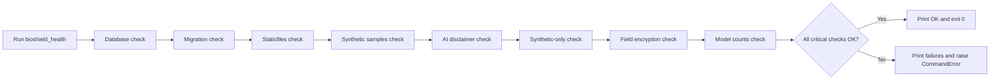

| Check | Success condition |
| --- | --- |
| `database` | `SELECT 1` succeeds |
| `migrations` | All project migrations applied |
| `staticfiles` | `STATIC_ROOT` directory exists |
| `synthetic_samples` | All five sample files present |
| `ai_disclaimer` | Disclaimer text matches exactly |
| `synthetic_only` | `SYNTHETIC_DATA_ONLY` enabled |
| `field_encryption` | `FIELD_ENCRYPTION_KEY` configured |
| `model_counts` | All model counts readable |

---

## 18. Security model

| Control | Implementation | Operational note |
| --- | --- | --- |
| Authentication | Django sessions and DRF tokens | Rotate tokens and protect accounts |
| Authorization | Organization-scoped querysets and role checks | Review requires reviewer or admin role |
| Encryption | Fernet ciphertext for sensitive values | Protect the encryption key |
| Auditability | `AuditLog` and `AccessEvent` records | Review audit history regularly |
| Transport | HTTPS redirect, HSTS, secure cookies | Configure proxy headers correctly |
| Browser policy | CSP, CORP, COOP and permissions policy | Keep CDN allowlist intentional |
| Upload safety | Extension and size validation | Synthetic files only |
| Synthetic enforcement | Default on, verified by health check | Never substitute real records |

### 18.1 Security review flow

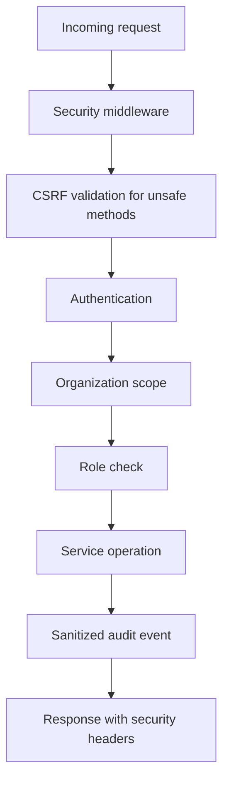

---

## 19. Synthetic samples

| File | Format | Purpose |
| --- | --- | --- |
| `synthetic_patient_summary.txt` | Plain text | Fabricated patient summary source |
| `synthetic_clinical_notes.txt` | Plain text | Fabricated clinical notes source |
| `synthetic_patient_summary.pdf` | PDF | Generated sample PDF |
| `synthetic_clinical_notes.docx` | DOCX | Generated sample Word document |
| `synthetic_access_events.csv` | CSV | Fabricated access event dataset |
| `generate_synthetic_documents.py` | Python | Regenerates PDF and DOCX samples |

All placeholder identities include names such as Avery Placeholder, Casey Testcase and Sample Auditor, invented organizations such as Northwind Example Clinic, reserved `.invalid` email domains and documentation-only IP ranges.

Regenerate samples:

```powershell
python samples/generate_synthetic_documents.py
```

---

## 20. Troubleshooting

| Symptom | Likely cause | Resolution |
| --- | --- | --- |
| `DJANGO_SECRET_KEY must be set` | No secret configured | Copy `.env.example` to `.env` and set the key |
| Database connection refused | PostgreSQL not running | Start the `db` service or use `DJANGO_TEST_DB=True` locally |
| Static files missing | `collectstatic` not run | Run `python manage.py collectstatic --noinput` |
| Health check reports `field_encryption` fail | Fernet key absent | Set `FIELD_ENCRYPTION_KEY` |
| Health check reports `migrations` fail | Migrations not applied | Run `python manage.py migrate` |
| CSP blocks charts or CDN scripts | CSP too strict | Update `CONTENT_SECURITY_POLICY` |
| Celery tasks never complete | Worker or Redis unavailable | Start Redis and the Celery worker |
| Review button hidden | User role is not reviewer or admin | Use a reviewer/admin account |
| Real-looking value appears in UI | Synthetic data rule misused | Stop and replace with fabricated data only |
| Docker healthcheck fails at `/` | Wrong health path in custom config | Use `/health/ready/` |

---

## 21. Documentation files

| File | Content |
| --- | --- |
| `docs/architecture.md` | Architecture notes and component responsibilities |
| `docs/api.md` | REST endpoint reference |
| `docs/deployment.md` | Production deployment guide |
| `docs/security.md` | Security control documentation |
| `docs/er-diagram.md` | Entity relationship details |
| `docs/compliance-disclaimer.md` | Legal limitation statement |
| `docs/sample-reports/SAMPLE-risk-assessment.md` | Sample risk report |
| `docs/sample-reports/SAMPLE-deidentification-summary.md` | Sample masking report |
| `docs/sample-reports/SAMPLE-access-review.md` | Sample access review |

---

## 22. License

Released under the MIT License.

**Copyright (c) 2026 n j bala manikantan**

The full license text is available in [`LICENSE`](LICENSE).
