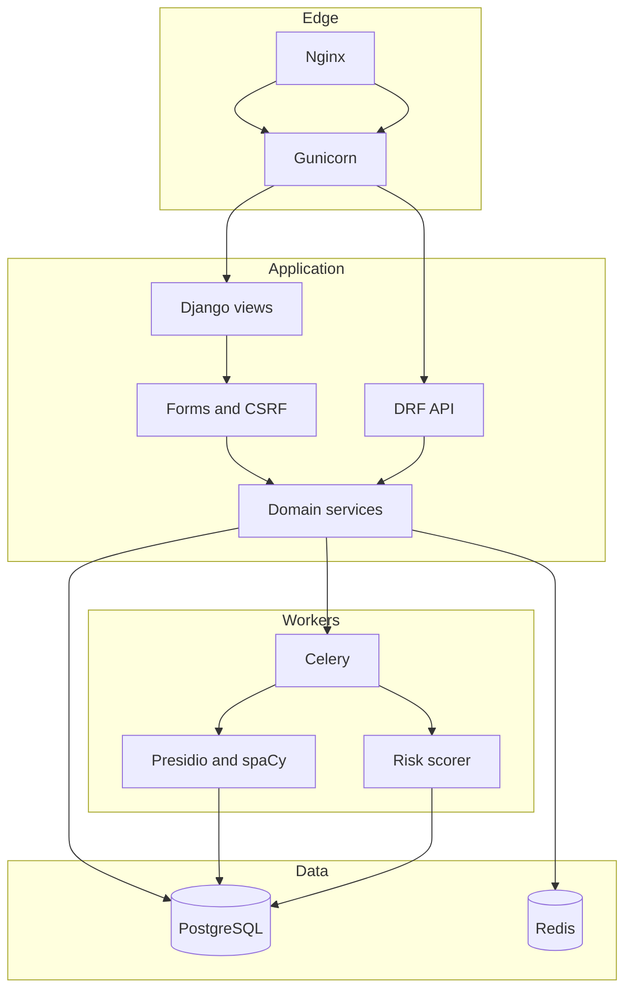
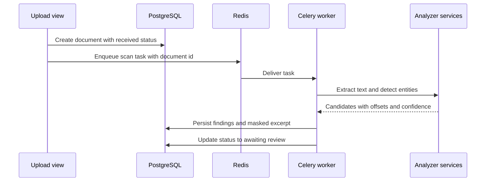

# Architecture

BioShield is a layered Django application designed for a synthetic-only privacy workflow. The UI is server-rendered Django templates enhanced with custom JavaScript; long-running analysis work is delegated to Celery workers.

## Layers

| Layer | Components | Responsibility |
| --- | --- | --- |
| Presentation | `templates/`, `static/css/main.css`, `static/js/` | Responsive glassmorphism UI, charts and 3D shield |
| Application | Django apps in `config/`, `accounts/`, `organizations/`, `documents/`, `analysis/`, `audit/`, `dashboard/`, `compliance/`, `reports/` | Views, forms, business rules and serialization |
| Integration | Django REST Framework, Celery tasks | JSON API and asynchronous processing pipeline |
| Detection | Presidio Analyzer/Anonymizer, spaCy, scikit-learn | Candidate entities, masking strategies and risk scoring |
| Persistence | PostgreSQL, Redis | Application records and task broker/cache |
| Edge | Nginx, Gunicorn, WhiteNoise | TLS termination, proxying and static delivery |

## Component diagram

## Request lifecycle

1. Nginx forwards the request to Gunicorn and adds security headers.
2. `BioShieldSecurityMiddleware` assigns a request identifier and adds response headers including CSP.
3. Django URL dispatch resolves the view and applies authentication or role checks.
4. Views read/write through the ORM and enqueue Celery tasks when scanning is requested.
5. Templates render with CSRF metadata, messages and a JSON metrics block for Chart.js.
6. Static JavaScript enhances navigation, tables, forms, highlighting and the Three.js scene.
7. Audit events are written for document access, review decisions and exports.

## Asynchronous pipeline

## Design decisions

- **Server-rendered first:** core content is readable without JavaScript; charts and 3D are progressive enhancements.
- **Safe DOM updates:** dashboard and highlight scripts use `textContent` and `createElement`, never untrusted `innerHTML`.
- **Human-in-the-loop:** findings are candidates until a reviewer records a decision.
- **Explicit synthetic mode:** banners, samples and documentation state that no real patient data is used.
- **Separation of concerns:** detection logic lives in `analysis/`, evidence trails in `audit/`, reporting in `reports/`.
- **No Docker socket:** compose services do not require privileged host access.

## Extension points

- Add analyzers behind the `analysis/` service interface and record their name on each finding.
- Add frameworks in `compliance/` without changing the findings pipeline.
- Replace bundled model artifacts via `AI_MODEL_PATH` and `RISK_MODEL_PATH`.
- Add report templates in `reports/` while keeping the report status set to `sample` until external approval exists.

## Health and observability

`/health/live/` reports process liveness and `/health/ready/` performs a database round trip. Every response includes `X-Request-ID`, which is also written to audit records for correlation.
