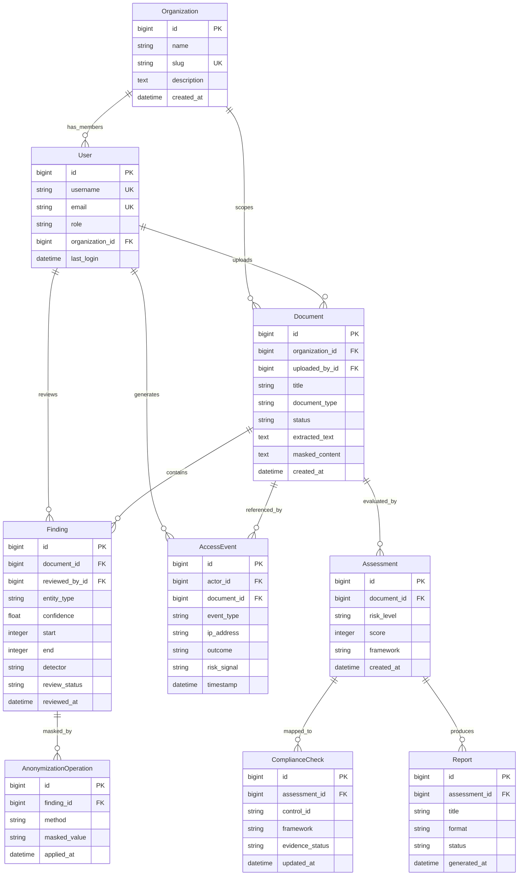

# Entity relationship diagram

The model below describes the synthetic workspace schema. All identifiers are internal database keys; displayed identifiers such as `SYN-MRN-000001` come only from fabricated sample files.

## Table notes

| Table | Notes |
| --- | --- |
| Organization | Provides workspace scoping; slug is unique and human readable. |
| User | Extends the Django user model with a role and organization reference. |
| Document | Stores extraction and masked text separately; status drives the review queue. |
| Finding | `start` and `end` are character offsets into extracted text; confidence is normalized from 0 to 1. |
| AnonymizationOperation | Records the masking method and replacement token for each accepted finding. |
| Assessment | Aggregates findings into a risk band and numeric score. |
| ComplianceCheck | Maps evidence to internal control identifiers; completion is not certification. |
| Report | Stores metadata for generated sample reports rather than treating reports as authoritative records. |
| AccessEvent | Append-only audit entries with request correlation and documented synthetic IP ranges in samples. |

## Indexing guidance

- Index `Document(organization_id, created_at)` for register queries.
- Index `Finding(document_id, review_status)` for queue queries.
- Index `AccessEvent(timestamp)` and `AccessEvent(actor_id, timestamp)` for audit filtering.
- Enforce uniqueness on `Organization.slug`, `User.username` and `User.email`.

## Retention

`RETENTION_DAYS` defaults to 365. A scheduled task may prune synthetic documents and audit rows after the window, subject to locally documented legal and operational requirements. Samples are intentionally disposable.
